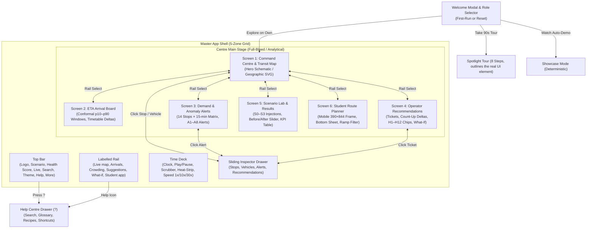

# RoutePulse — Application Map & Information Architecture

> Single source of truth for navigation structure, visual layout wireframes, and screen state transitions.
> Companion to `docs/ROUTEPULSE_UI_UX_SPEC.md` and `ROUTEPULSE_ARCHITECTURE.md`.

---

## 1. Application Navigation Flow (Mermaid Diagram)



---

## 2. Desktop Mission Control Wireframe (ASCII)

```
+----------------------------------------------------------------------------------------------------------------------+
| [RP] RoutePulse   Scenario: [S0 Morning Peak v]   [LIVE API]   Sim: 08:15   [--/\_/\_--]  Health: 92/100  [Schematic] [Tour] [O] [?] |
+---+--------------------------------------------------------------------------------------------------+---------------+
|   | (Zone 3: Full-Bleed Interactive Transit Map / Screen Stage)                                      | (Zone 4:      |
| M |                                                                                                  | Sliding       |
| A |     [Metro S13 Gateway]                                                                          | Inspector     |
| P |            \  (45° Corridor)                                                                     | Drawer)       |
|   |             \                                                                                    |               |
| E |              [S01 Main Gate] ===== [S02 Admin] ===== ◎ [S03 Central Hub] ===== [S04 Library]     | Selected:     |
| T |                                                            | (4m walk)                           | Bus B3        |
| A |                                                            |                                     | Load: 92%     |
|   |                                                      [S10 Food Court]                            | Status: HIGH  |
| A |                                                            |                                     | Next: S03     |
| L |                                                    [S08] ----- [S09]                             |               |
| T |                                                                                                  | [View Stops]  |
|   |   +------------------------------------------------------------------------------------------+   | [Follow Veh]  |
| R |   | [Zoom +] [Zoom -] [Fit All]  Layers: [x] Routes  [x] Load Rings  [x] Hub Ring  [x] Alerts|   |               |
| E |   +------------------------------------------------------------------------------------------+   | [Esc to Close]|
| C |                                                                                                  |               |
+---+--------------------------------------------------------------------------------------------------+---------------+
| (Zone 5: Time Deck)                                                                                                  |
| [ > Play ]  08:15:30   [Peak Jump]  |==== Heat-Strip: Teal...Amber...Coral...Teal ====|  Speed: [ 1x |(10x)| 30x ]     |
|                                     07:30       08:00       08:30(Peak)      09:30       10:30                       |
+----------------------------------------------------------------------------------------------------------------------+
```

---

## 3. Student Mobile View Wireframe (390 × 844)

```
+----------------------------------------+
| 08:15                      5G 100%     |
+----------------------------------------+
| RoutePulse Go               [ Now ]    |
|                                        |
| ORIGIN STATION                         |
| [ S13 — Metro Gateway                v]|
|                                        |
| DESTINATION STATION                    |
| [ S04 — Library                      v]|
|                                        |
| [x] Wheelchair Ramp Shuttles Only      |
+----------------------------------------+
| SUGGESTED ITINERARIES                  |
|                                        |
| +------------------------------------+ |
| | [R3] Depart 08:18      ~12 min trip| |
| |                                    | |
| | EXPECTED ARRIVAL (p50)   WINDOW    | |
| |  08:30 AM             08:27–08:33  | |
| |                                    | |
| | [!] Next bus is crowded (92% load) | |
| | Alternative 8m later is 58% full.  | |
| +------------------------------------+ |
|                                        |
| +------------------------------------+ |
| | [R3] Depart 08:26 (COMFORT PICK)   | |
| | Expected Arrival: 08:38 AM         | |
| | [✓] Comfortable seats available    | |
| +------------------------------------+ |
+----------------------------------------+
| [ Map ]      [ Search ]     [ Passes ] |
+----------------------------------------+
```

---

## 4. Screen-by-Screen Directory & Contracts

### Screen 1: Command Centre & Transit Map
- **Purpose:** Central mission control overview of all 14 stops, 4 route corridors, and active shuttle fleet.
- **Who uses it:** Transport Operations Director, Dispatcher.
- **Primary action:** Inspect vehicle load factors, monitor network stress, switch between Schematic and Geographic view modes.
- **Entry points:** Default home screen; navigation rail button 1.
- **Links to other screens:** Click stop -> Open Stop Inspector; Click vehicle -> Open Vehicle Inspector; Click alert badge -> Jump to Demand & Alerts.

### Screen 2: ETA Arrival Board
- **Purpose:** Station-by-station arrival boards showing calibrated p10–p90 arrival windows and timetable adherence.
- **Who uses it:** Dispatcher, Passenger Information Officer, Reviewer.
- **Primary action:** Filter by station; inspect arrival confidence bounds and plain-language delay factors.
- **Entry points:** Navigation rail button 2; "Open Full ETA Board" from Inspector Drawer.
- **Links to other screens:** Direct station links; Help drawer.

### Screen 3: Demand & Anomaly Alerts
- **Purpose:** Stop-by-time demand heatmap (14 stops × 15-minute slots) and prioritised A1–A8 bottleneck alerts.
- **Who uses it:** Demand Planner, Operations Manager.
- **Primary action:** Filter alerts by severity (Hard risk vs Soft); inspect quantile sizing distributions (P50/P80/P90).
- **Entry points:** Navigation rail button 3; Disruption alert banner.
- **Links to other screens:** "Show on Map" jumps to Command Centre with offending entity highlighted.

### Screen 4: Operator Recommendations
- **Purpose:** AI Copilot recommendation cards generated by CP-SAT solver to relieve overcrowding with 0 constraint violations.
- **Who uses it:** Dispatcher, Operations Director.
- **Primary action:** Review Gain vs Cost trade-offs, verify H1–H12 constraint chips, Accept recommendation to update working plan live.
- **Entry points:** Navigation rail button 4; "View Optimization Solutions" from Alert Inspector.
- **Links to other screens:** "Try What-If" opens discrete-event simulation sandbox.

### Screen 5: Scenario Lab & Plan Evaluation
- **Purpose:** Stress-test system resilience by injecting real-world disruptions (S0–S3) and benchmarking Baseline-0 vs RoutePulse.
- **Who uses it:** Executive Reviewer, Transport Director, Hackathon Judge.
- **Primary action:** Drag the Before/After reveal slider; inject S1 traffic delay, S2 vehicle breakdown, or S3 demand surge.
- **Entry points:** Navigation rail button 5; Disruption banner "Scenario Lab" button.
- **Links to other screens:** Live map updates when disruptions are triggered.

### Screen 6: Student & Traveler View
- **Purpose:** Mobile-first journey planner tailored to students, campus staff, and visitors.
- **Who uses it:** Campus students, mobility-impaired passengers, visitors.
- **Primary action:** Select origin/destination; toggle step-free wheelchair access; choose between immediate departure and uncrowded alternative.
- **Entry points:** Navigation rail button 6; Welcome modal role selector.
- **Links to other screens:** Toggle between Mobile 390×844 simulator frame and expanded view.

### Overlay: Help Centre Drawer & Glossary
- **Purpose:** Comprehensive searchable reference for definitions, operational recipes, user paths, and keyboard shortcuts.
- **Who uses it:** All roles.
- **Primary action:** Search glossary, read step-by-step how-to recipes, replay 90-second tour.
- **Entry points:** Top bar `?` button; keyboard shortcut `?`.
