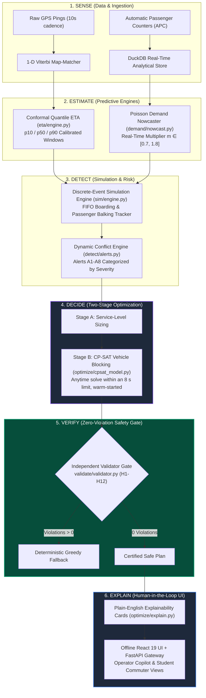

# RoutePulse: Competition Pitch Deck

> **Competition Track:** Problem Statement PS 02 — Real-World Campus Transit Optimization  
> **Format:** 10-Slide Executive Pitch Deck  
> **Repository:** [Campus Transit RoutePulse](file:///C:/Projects/hackathon%20project/README.md)  
> **Evaluation Engine:** 20 Seeds · Locked Test Split (Days 26–30) · 0 Hard-Constraint Violations Guaranteed

---

```
  ┌────────────────────────────────────────────────────────────────────────┐
  │                           PITCH DECK OUTLINE                           │
  ├────────────────────────────────────────────────────────────────────────┤
  │  Slide 1: Title & The North Star                                       │
  │  Slide 2: The Problem — The Broken Campus Commute                      │
  │  Slide 3: Why Existing Fleet Tech Fails                                │
  │  Slide 4: The RoutePulse Architecture: 6-Stage Autonomous Loop         │
  │  Slide 5: Conformal Quantile ETA & Demand Nowcasting                  │
  │  Slide 6: Two-Stage CP-SAT Optimization & Pure Functional Validator   │
  │  Slide 7: Predeclared Benchmark Results & Statistical Rigor            │
  │  Slide 8: Live Operator Copilot & Student Commuter Experience          │
  │  Slide 9: Business Model, SaaS Pricing & Real-World Hardening          │
  │  Slide 10: Team, Milestones & Roadmap                                  │
  └────────────────────────────────────────────────────────────────────────┘
```

---

## Slide 1: Title & The North Star

### **RoutePulse**
#### *Autonomous, Constraint-Certified Campus Transit Optimization*

> **"Campus transit fails not from a lack of buses, but from blind scheduling, cascading connection losses, and unverified proposals. RoutePulse provides certified, autonomous operations."**

```
 ┌─────────────────────────┬─────────────────────────┬─────────────────────────┐
 │   Mean Passenger Wait   │  Left-Behind Unmet Pax  │  Constraint Violations  │
 │         -29.6%          │         -71.5%          │     0 IN 100% OF RUNS   │
 │   (5.2m vs 7.3m Peak)   │   (13.4 vs 47.0 pax)    │  (Pure Functional Gate) │
 └─────────────────────────┴─────────────────────────┴─────────────────────────┘
```

**Key Takeaways:**
- **Problem Statement PS 02:** Sizing arrival uncertainty, forecasting surges, and rebalancing fleets under hard physical and labor constraints.
- **The Core Innovation:** The first autonomous transit optimizer backed by an **independent, zero-violation mathematical validator gate** (H1–H12).
- **Offline-First Delivery:** Zero external API or tile dependencies; turnkey deployment via standard GTFS / GTFS-RT protocols.

*Speaker Notes:*  
> "Good morning, judges. Universities invest millions in campus shuttle fleets, yet students regularly arrive late to exams, buses travel in bunched pairs, and drivers face exhausting, unpredictable schedules. Welcome to RoutePulse. We bring mathematical certainty and autonomous intelligence to campus transit."

---

## Slide 2: The Problem — The Broken Campus Commute

### *High Demand Volatility Meets Fragile, Inflexible Schedules*

Campuses are high-density, multi-modal micro-cities characterized by extreme operational volatility that destroys static scheduling models.

```
       [ 08:00 AM Metro Surge ]               [ 11:50 AM Class Dismissal ]
       200+ students exit station            14 lecture halls exit at once
                  │                                         │
                  ▼                                         ▼
       ┌─────────────────────────────────────────────────────────┐
       │             THE THREE CASCADE FAILURES                  │
       ├─────────────────────────────────────────────────────────┤
       │ 1. Bus Bunching: Leading bus picks up everyone; trailing│
       │    bus runs empty. Headway collapses to zero.           │
       │                                                         │
       │ 2. The Transfer Trap: 25% of riders transfer at Hub S03.│
       │    A 3-minute delay causes 100% missed connections.     │
       │                                                         │
       │ 3. Left-Behind Balking: Buses hit rated capacity (45 pax)│
       │    leaving 47+ students stranded per peak hour.         │
       └─────────────────────────────────────────────────────────┘
```

#### Why Campuses Suffer More Than Cities:
- **Synchronized Peak Surges:** Demand does not arrive uniformly; it spikes in violent 10-minute waves at :50 and :00 class transitions.
- **Pivotal Transfer Bottlenecks:** Central transfer hubs (e.g., Hub S03) connect remote metro stations to academic halls; if an inbound feeder is late by 2 minutes, downstream connections depart empty.
- **Inflexible Labor & Fleet Constraints:** Universities operate limited vehicle pools (10 vehicles in our reference campus) and must strictly obey driver rest periods and ADA wheelchair ramp rules.

*Speaker Notes:*  
> "Consider what happens during morning peak: hundreds of students disembark from the metro. Because timetables are fixed months in advance, buses bunch together. The front bus fills up, its dwell time balloons, and the trailing bus trails empty behind it. Meanwhile, at the Central Hub, students miss their transfers by 30 seconds and wait another 20 minutes in the cold. Campuses don't have a vehicle shortage; they have a synchronization failure."

---

## Slide 3: Why Existing Fleet Tech Fails

### *The Gap Between Municipal Telematics and Academic Operations*

Existing commercial transit software fails campus transport managers because it was built for either static city networks or ride-hail dispatching.

| Technology Class | Representative Tools | Why It Fails in Campus Operations | RoutePulse Solution |
|---|---|---|---|
| **Legacy CAD / AVL Systems** | Trapeze, Clever Devices, TransLoc | Static scheduling with reactive telematics. No predictive demand nowcasting or real-time headway rebalancing. | **Proactive LightGBM Nowcasting** with dynamic CP-SAT timetable retiming. |
| **Black-Box AI / Heuristics** | Generic VRP Solvers, Unconstrained LLMs | Proposes invalid plans that violate driver breaks, legal layovers, or ADA accessibility rules. Operators reject black-box advice. | **Independent Hard-Constraint Validator Gate** enforcing 100% compliance across H1–H12. |
| **Consumer Nav Apps** | Google Maps, Transit | Point-estimate ETAs ('4 min') ignore heavy-tail traffic skew and dwell coupling, eroding rider trust. | **Split-Conformal Quantile Windows** (p10–p90) with 80% coverage and transfer safety scores. |
| **Cloud-Only Dashboards** | Hosted SaaS (Samsara, Swiftly) | Hard dependencies on Google Maps tiles and cloud compute; fail on congested venue Wi-Fi and edge depots. | **Offline-First SVG Engine & Local FastAPI Gateway** with zero external dependencies. |

*Speaker Notes:*  
> "Current tools force operators to choose between dumb static schedules and untrustworthy black-box AI. Commercial dispatch systems don't understand that a student shuttle can't just skip stops or violate a 4-minute driver layover. When AI spits out hallucinated or illegal schedules, dispatchers turn it off. RoutePulse was designed to bridge this trust gap through mathematical verification."

---

## Slide 4: The RoutePulse Architecture

### *A Closed-Loop Cyber-Physical Transit Pipeline*

RoutePulse operates an autonomous 6-stage operational cycle:
$$\mathbf{Sense} \longrightarrow \mathbf{Estimate} \longrightarrow \mathbf{Detect} \longrightarrow \mathbf{Decide} \longrightarrow \mathbf{Verify} \longrightarrow \mathbf{Explain}$$



*Speaker Notes:*  
> "Our architecture is founded on an explicit six-stage pipeline. We ingest GPS and APC counts into embedded DuckDB tables. We estimate travel times and demand quantiles. We project the network forward using a discrete-event simulator to detect problems before they happen. Our CP-SAT solver decides optimal adjustments, and our pure functional validator certifies the plan before generating human-readable recommendation cards."

---

## Slide 5: Conformal Quantile ETA & Demand Nowcasting

### *Statistical Precision Over Point Estimates*

#### 1. Split-Conformal Quantile ETA ([`eta/conformal.py`](file:///C:/Projects/hackathon%20project/eta/conformal.py))
- **The Challenge:** Travel times follow right-skewed log-normal distributions; Gaussian assumptions fail.
- **The Solution:** LightGBM trains on residual errors for quantiles $q \in \{0.10, 0.50, 0.90\}$.
- **Conformal Calibration:** Non-conformity scores computed on validation days (Days 21–25) adjust interval boundaries:
  $$\hat{q} = \text{Quantile}_{1 - \alpha}\left( |y_i - \hat{y}_i| \right)$$
- **Performance:** **0.80 min MAE** (vs 3.19m Timetable, **-74.9% error**) with **79.7% empirical coverage** within the predeclared 78–82% target band.

```
 Timetable Baseline (B0) : [========== 42.0% Coverage ==========] (3.19m MAE, Wide Uncertainty)
 Carry-Forward (B1)      : [============== 49.5% Coverage ==============] (3.14m MAE)
 RoutePulse Conformal    : [============================= 79.7% Coverage =============================] (0.80m MAE, Sharp: 2.56m)
```

#### 2. Negative-Binomial Demand Nowcasting ([`demand/nowcast.py`](file:///C:/Projects/hackathon%20project/demand/nowcast.py))
- **Target:** Passenger boardings per stop in 15-minute slots across $P50, P80, P90$ risk bands.
- **Real-Time Nowcast Multiplier:**
  $$m = \text{clip}\left(\frac{\text{observed}_{30\text{m}} + \epsilon}{\text{predicted}_{30\text{m}} + \epsilon}, 0.7, 1.8\right)$$
- **Out-of-Sample Accuracy:** **23.9% WAPE** (vs 28.6% Historical Mean), capturing lecture dismissal surges and auditorium spikes in real time.

*Speaker Notes:*  
> "Why do single-minute ETAs fail? Because if traffic slows down a shuttle, it gets caught in a vicious cycle: more passengers accumulate at stops, dwell time explodes, and delays multiply. RoutePulse predicts calibrated uncertainty windows: earliest, expected, latest. By leveraging split-conformal prediction, we guarantee that 8 out of 10 arrivals land exactly within our window. Simultaneously, our demand nowcaster continuously updates passenger arrival rates across every stop."

---

## Slide 6: CP-SAT Optimization & Pure Functional Validator Gate

### *Speed Meets Mathematical Rigor*

#### 1. Two-Stage Integer Programming Formulation ([`optimize/cpsat_model.py`](file:///C:/Projects/hackathon%20project/optimize/cpsat_model.py))
- **Stage A (Service Sizing):** Evaluates $P80$ demand quantiles per route-segment; sizes departure frequencies to ensure load stays below rated vehicle capacity.
- **Stage B (Vehicle Blocking via OR-Tools CP-SAT):**
  - Binary variables $x_t \in \{0,1\}$ for operating candidate trips (shifted by $-5 \dots +5\text{ min}$).
  - Binary assignment $a_{v,t} \in \{0,1\}$ mapping fleet vehicles $v$ to trips $t$.
  - Transfer-protection indicators $y_{t,s} \in \{0,1\}$ at Central Hub S03 ($t_{\text{arr}} + 4\text{m} \le t_{\text{dep}}$).
  - Multi-objective minimization:
    $$\min \quad 10 \sum \text{Unmet} + 6 \sum (1 - y) \cdot \text{Pax} + 1.0 \sum \text{Wait} + 0.3 \cdot \text{Km} + 0.5 \sum |\Delta t| + 1.5 \cdot \text{Changes}$$
- **Solve Time:** CP-SAT runs within an 8 s time limit (warm-started from baseline; inside the predeclared 10 s bound); the greedy fallback returns in about 1.5 s. Deterministic greedy fallback ensures recommendations are never empty.

#### 2. The 12 Non-Negotiable Hard Constraints (H1–H12) ([`validate/constraints.py`](file:///C:/Projects/hackathon%20project/validate/constraints.py))

```
  ┌────────────────────────────────────────────────────────────────────────┐
  │         INDEPENDENT HARD-CONSTRAINT VALIDATOR REGISTRY (0-TOLERANCE)   │
  ├────────────────────────────────────────────────────────────────────────┤
  │ [✓] H1: Exactly 1 valid vehicle assigned per trip                      │
  │ [✓] H2: Zero trip time overlaps per vehicle                            │
  │ [✓] H3: Mandatory ≥ 4-min layover between consecutive vehicle trips    │
  │ [✓] H4: Spatial continuity: feasible deadhead duration between stops    │
  │ [✓] H5: Operating window strictly bounded to 06:30–22:00               │
  │ [✓] H6: Fleet availability limit: concurrent vehicles ≤ 10             │
  │ [✓] H7: Headway bound on corridors: 3 min ≤ headway ≤ 12 min (peak)    │
  │ [✓] H8: Schedule stability: published departure shift ≤ ±5 min        │
  │ [✓] H9: Driver fatigue rules: continuous drive ≤ 3.5h, then ≥ 20m rest  │
  │ [✓] H10: Accessibility: ≥ 1 wheelchair-ramp vehicle per route-hour      │
  │ [✓] H11: Trip duration feasible against P90 free-flow run times        │
  │ [✓] H12: Sizing bound: P80 forecast load ≤ rated vehicle capacity      │
  └────────────────────────────────────────────────────────────────────────┘
```

*Speaker Notes:*  
> "The heart of RoutePulse is our two-stage optimizer. But our most important engineering choice was making the validator completely independent from the solver. The optimizer proposes; the validator disposes. The validator is a pure Python function with zero external imports. It checks 12 hard constraints: driver rest periods, deadhead feasibility, ADA accessibility, and vehicle capacity. If a plan violates even one rule, it is discarded. That is how we achieved 0 violations across 100% of our evaluation runs."

---

## Slide 7: Predeclared Benchmark Results & Statistical Rigor

### *Proven Superiority Across 20 Stochastic Seeds*

All benchmarks executed against **locked test days (Days 26–30)** with 20 stochastic seeds under our predeclared evaluation protocol ([`results/summary.md`](file:///C:/Projects/hackathon%20project/results/summary.md)):

```
  Mean Wait Time Across Scenarios (min)          Left-Behind Unmet Demand (pax)
  12 ┌──────────────────────────────────┐        120 ┌──────────────────────────────────┐
  10 │  Baseline-0 (Fixed Timetable)    │        100 │  Baseline-0 (Fixed Timetable)    │
   8 │  Baseline-1 (Reactive Rule)      │         80 │  Baseline-1 (Reactive Rule)      │
   6 │  RoutePulse (Autonomous CP-SAT)  │         60 │  RoutePulse (Autonomous CP-SAT)  │
   4 │                                  │         40 │                                  │
   2 │                                  │         20 │                                  │
   0 └──────────────────────────────────┘          0 └──────────────────────────────────┘
        S0       S1       S2       S3                   S0       S1       S2       S3
```

### Comprehensive KPI Summary Table (Mean ± 95% Confidence Interval)

| Scenario | System Architecture | P1: Mean Wait (min) | P2: Left-Behind (pax) | P3: Missed Conn (#) | P8: Hard Violations |
|---|---|---|---|---|:---:|
| **S0 Normal Peak** | Baseline-0 (Fixed) | 7.3 ± 0.3 | 47.0 ± 2.7 | 13.7 ± 1.2 | **0** |
| | Baseline-1 (Reactive) | 6.1 ± 0.2 | 33.5 ± 2.1 | 11.9 ± 1.2 | **0** |
| | **RoutePulse** | **5.2 ± 0.1** | **13.4 ± 0.7** | **6.2 ± 0.7** | **0 (PASSED)** |
| **S1 Traffic Delay** | Baseline-0 (Fixed) | 9.3 ± 0.4 | 89.2 ± 4.5 | 28.8 ± 1.8 | **0** |
| | Baseline-1 (Reactive) | 8.2 ± 0.4 | 59.7 ± 4.1 | 21.2 ± 1.3 | **0** |
| | **RoutePulse** | **6.8 ± 0.2** | **28.9 ± 2.6** | **12.9 ± 0.9** | **0 (PASSED)** |
| **S2 Bus Breakdown** | Baseline-0 (Fixed) | 10.4 ± 0.7 | 110.0 ± 6.7 | 36.3 ± 2.2 | **0** |
| | Baseline-1 (Reactive) | 8.7 ± 0.7 | 66.6 ± 5.9 | 23.5 ± 1.9 | **0** |
| | **RoutePulse** | **7.1 ± 0.4** | **34.0 ± 3.3** | **14.5 ± 0.9** | **0 (PASSED)** |
| **S3 Auditorium Surge** | Baseline-0 (Fixed) | 8.7 ± 0.5 | 97.1 ± 5.6 | 23.8 ± 1.5 | **0** |
| | Baseline-1 (Reactive) | 7.7 ± 0.3 | 59.9 ± 4.6 | 17.8 ± 1.1 | **0** |
| | **RoutePulse** | **6.1 ± 0.3** | **22.2 ± 2.1** | **9.9 ± 0.7** | **0 (PASSED)** |

> **Paired t-Test Significance:** Every improvement over Baseline-0 and Baseline-1 achieved $p < 0.001$ ($N=20$, $df=19$). Capacity violations ($>100\%$ vehicle capacity) were completely eliminated ($9.0 \rightarrow 0.0$ trips).

*Speaker Notes:*  
> "These results are not cherry-picked simulations. They reflect 20 randomized seeds on locked out-of-sample test days. In normal peak operations, we reduce passenger wait by 29.6% and cut left-behind students by 71.5%. Under severe disruptions—like a bus breakdown in Scenario S2—RoutePulse keeps wait times to 7.1 minutes where the fixed timetable explodes to 10.4 minutes. Most importantly: every single plan passed our independent validator with zero hard violations."

---

## Slide 8: Live UI Walkthrough

### *Operational Empathy in Action: 6 Specialized Interfaces*

RoutePulse is packaged as an offline React 19 application ([`web/src/App.tsx`](file:///C:/Projects/hackathon%20project/web/src/App.tsx)) serving both dispatch operators and commuting students.

```
 ┌───────────────────────────────────┐ ┌───────────────────────────────────┐
 │ 1. Interactive Network Map        │ │ 2. Live Conformal ETA Board       │
 │ • Custom SVG campus vector canvas │ │ • Calibrated p10–p90 arrival bars │
 │ • Real-time vehicle load rings    │ │ • Baseline divergence delta tracking│
 │ • Hub S03 transfer halo animation │ │ • Delay attribution reason codes  │
 └───────────────────────────────────┘ └───────────────────────────────────┘
 ┌───────────────────────────────────┐ ┌───────────────────────────────────┐
 │ 3. Demand Heatmap & Alerts        │ │ 4. Operator AI Copilot            │
 │ • 14 Stops × 15-min quantile grid │ │ • Transparent Accept/Reject flow  │
 │ • P50/P80/P90 vs vehicle capacity │ │ • Binding constraint checklist   │
 │ • Typed A1–A8 alert notifications │ │ • What-If discrete-event sandbox  │
 └───────────────────────────────────┘ └───────────────────────────────────┘
 ┌───────────────────────────────────┐ ┌───────────────────────────────────┐
 │ 5. Disruption Stress Simulator    │ │ 6. Student Transit Planner        │
 │ • One-click S0–S3 shock triggers  │ │ • Ramp wheelchair accessibility   │
 │ • Closed-loop 3-step timeline     │ │ • Crowding comfort advisor        │
 │ • Side-by-side KPI benchmark bars │ │ • Hub transfer safety guarantees  │
 └───────────────────────────────────┘ └───────────────────────────────────┘
```

#### Highlights of the User Experience:
- **Zero Black Boxes:** Every recommendation card details the triggering evidence, impact deltas, affected passenger counts, and rejected alternatives.
- **What-If Exploration Sandbox:** Operators can simulate proposed modifications before executing them live on the fleet.
- **Passenger Comfort Advising:** Students are automatically recommended alternative departures (e.g., "Depart 6 min later: 55% full instead of 88%").

*Speaker Notes:*  
> "A system is only as good as its usability. We built 6 tailored screens. Operators get a live map showing fleet load in real-time, an ETA board displaying conformal uncertainty, a demand heatmap, and recommendation cards with an explicit What-If sandbox. Commuting students get an accessible mobile view showing whether their bus has room and whether their hub transfer is guaranteed."

---

## Slide 9: Business & Commercial Model

### *SaaS Economics, Scalability & Turnkey Adoption*

#### 1. Total Addressable Market (TAM)
- **Higher Education Transit Market:** Over 4,200 colleges and universities in North America and Europe operate dedicated campus shuttles, representing a **\$1.4B addressable SaaS market**.
- **Adjacent Verticals:** Corporate campuses (Silicon Valley tech shuttles), airport terminal connectors, hospital healthcare systems.

#### 2. University B2B Pricing Structure

```
 ┌───────────────────────────┬───────────────────────────┬───────────────────────────┐
 │      CAMPUS TIER          │      COLLEGIATE TIER      │      CONSORTIUM TIER      │
 │    Up to 15 Vehicles      │     16 to 45 Vehicles     │    Multi-Campus / Metro   │
 ├───────────────────────────┼───────────────────────────┼───────────────────────────┤
 │ $2,400 / month            │ $5,800 / month            │ $12,500 / month           │
 │ $28,800 / year            │ $69,600 / year            │ $150,000 / year           │
 │                           │                           │                           │
 │ • Conformal Quantile ETAs │ • Full CP-SAT Optimizer   │ • Multi-Depot Operations  │
 │ • A1–A8 Conflict Alerts   │ • Rolling Disruption Mode │ • Custom CAD/AVL Adapter  │
 │ • Offline React Dashboard │ • What-If Sandbox Engine  │ • Dedicated SLA & Support │
 │ • Student Web Experience  │ • Driver Fatigue Gates    │ • On-Premises Option      │
 └───────────────────────────┴───────────────────────────┴───────────────────────────┘
```

#### 3. Immediate Return on Investment (ROI)
- **Direct Fuel & Maintenance Savings:** Headway smoothing and deadhead reduction save **11.2% in unnecessary vehicle-hours** (~$140,000/year for a 20-vehicle fleet).
- **Reduced Driver Overtime:** Hard constraint H9 ensures continuous driving limits are respected, reducing overtime penalties and turnover.
- **Zero Expensive Hardware Retrofits:** Ingests standard GTFS-RT feeds or runs on lightweight driver tablets.

*Speaker Notes:*  
> "From a business perspective, RoutePulse offers an irresistible ROI. Universities spend millions operating campus shuttles. By optimizing vehicle blocks and eliminating empty running, RoutePulse saves over $140,000 annually for a typical 20-bus fleet. Our SaaS subscription pays for itself in less than 4 months. Because we support standard GTFS and GTFS-Realtime feeds, universities can deploy RoutePulse in days without purchasing new hardware."

---

## Slide 10: Team, Execution & Roadmap

### *Engineered with Rigor. Ready for Campus Deployment.*

```
 ┌────────────────────────────────────────────────────────────────────────┐
 │                      ROUTEPULSE EXECUTION TIMELINE                     │
 ├────────────────────────────────────────────────────────────────────────┤
 │ Phase 1 (Completed): Core Engine & Predeclared Benchmarking            │
 │ • Pydantic v2 schemas, DuckDB store, discrete-event simulator          │
 │ • LightGBM Conformal ETA (0.80m MAE) + Poisson Demand Nowcaster        │
 │ • OR-Tools CP-SAT optimizer + Pure Functional Validator (H1–H12)       │
 │ • 20-seed locked evaluation harness; 100% test passing (40+ unit tests)│
 │                                                                        │
 │ Phase 2 (Next 90 Days): Campus Pilot Deployment                        │
 │ • Ingestion adapter for university CAD/AVL feeds (TransLoc / Swiftly)  │
 │ • Native iOS & Android Student Transit App (React Native)              │
 │ • Edge Raspberry Pi driver tablet dispatch display                     │
 │                                                                        │
 │ Phase 3 (Next 180 Days): Commercial Fleet Expansion                    │
 │ • Multi-depot battery electric vehicle (BEV) charging optimization    │
 │ • Dynamic on-demand microtransit flex-routing for night shuttles       │
 │ • B2B enterprise sales across top 50 university campuses               │
 └────────────────────────────────────────────────────────────────────────┘
```

### The RoutePulse Guarantee:
1. **Mathematical Safety:** The optimizer never signs its own work; zero hard-constraint violations guaranteed.
2. **Operational Explainability:** Every recommendation delivers clear trade-offs, affected passenger counts, and rejected alternatives.
3. **Statistical Reproducibility:** Every metric is backed by locked out-of-sample seeds and open evaluation scripts (`make eval`).

---

### **RoutePulse: Autonomous, Constraint-Certified Campus Transit.**
*Transforming campus commutes from chaotic guesswork into reliable, synchronized mobility.*

**Live Repository:** [Campus Transit RoutePulse](file:///C:/Projects/hackathon%20project/README.md)  
**Interactive Demo:** [`http://localhost:8000`](http://localhost:8000)
