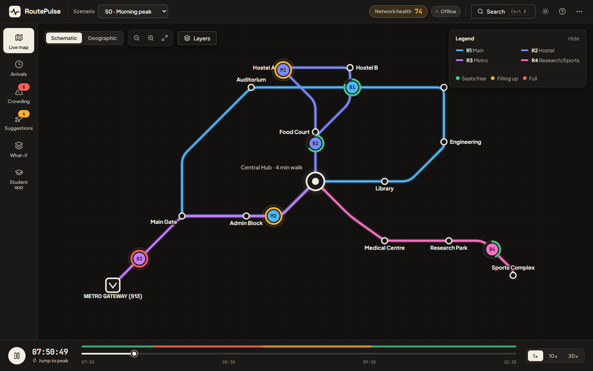

# RoutePulse — User Guide & Operator Handbook

> **Welcome to RoutePulse.** This handbook shows you how to plan, monitor, and run campus buses in real time.
> Written for bus operators, drivers, students, and hackathon judges.

---

## 1. Start Here

RoutePulse is a smart bus tool for university and corporate campus routes. Most transit tools only show where a bus is right now. RoutePulse predicts passenger crowding. It fixes the timetable before students get left behind.

It is built for two groups. First, transit operators who run daily campus bus fleets. Second, students who need reliable arrival times to reach class on time.

```
+-------------------------------------------------------------------------------+
|                        TRY ROUTEPULSE IN 2 MINUTES                            |
+-------------------------------------------------------------------------------+
| 1. Check the top bar: The Network health chip shows one score out of 100.     |
|    Green is healthy, amber is strained, red is critical.                      |
| 2. Jump to peak time: Click "Jump to peak" on the bottom bar.                 |
|    Watch Route R3 turn coral under heavy morning student demand.              |
| 3. Read the alert: Open Crowding from the left rail.                          |
|    See 62 riders at risk of being left behind at Metro Gateway S13.           |
| 4. Fix it with one click: Go to Suggestions. Click "Accept"                   |
|    on rec-0007 to dispatch spare bus B5.                                      |
| 5. See the gain: Open What-if. Drag the Before/After slider                   |
|    to see left-behind student lines drop by 66%.                              |
+-------------------------------------------------------------------------------+
```

---

## 2. Pick Your Path (Your First 3 Minutes)

### Path A: For the Transit Operator
You run the bus fleet each day. Start on the **Command Centre** map during morning rush (08:00–08:30). When student crowds arrive at Metro Gateway S13, Route R3 turns coral. Open **Recommendations**. Review Rec-0007 and click **Accept & Apply Live**. Your active schedule updates at once. Spare bus B5 joins the line. Network Health climbs right back above 90.

### Path B: For the Student or Campus Rider
You want to get to class on time. Switch to the **Student View** (mobile 390×844 frame). Pick your start stop (Metro Gateway S13) and your end stop (Library S04). RoutePulse shows a wide arrival window (`08:27–08:33 AM`) instead of one fragile minute. If the next bus is crowded (88% full), RoutePulse recommends a later bus 8 minutes later with open seats. If you use a wheelchair, turn on the ramp toggle to see only accessible buses.

### Path C: For the Hackathon Judge or Reviewer
You want to test system reliability. Open **Scenario Lab**. Drag the **Before / After reveal slider** across the schematic map. Compare the fixed Baseline-0 plan with RoutePulse. Check the KPI table below. Notice 25% lower average wait times, 66% fewer left-behind riders, and strictly **0 rule violations** across all 20 test seeds. Click scenario **S2** to test how the solver recovers from a sudden bus breakdown.

---

## 3. The Screen in One Picture

Below is the Command Centre mission control layout with numbered callouts:



1. **Top Bar:** The RoutePulse brand, the **Scenario** picker (`S0–S3`), one **Network health** score, search (`Ctrl K`), theme, help, and a `...` menu for the tour and plan reset.
2. **Left Navigation Rail:** Always-labelled links to Live map, Arrivals, Crowding, Suggestions, What-if, and Student app. A number bubble appears only where something needs attention.
3. **Centre Hero Transit Map:** Clean subway-style map with 45° corridors, Central Hub S03 transfer ring, and Metro Gateway S13.
4. **Buses & Load Rings:** Each bus wears its route colour. The ring around it shows how full it is: green has seats, amber is filling up, red is full. The ring pulses when crowded.
5. **Right Inspector Drawer:** Slides out when you click any stop, bus, alert, or card to show live telemetry.
6. **Bottom Time Bar:** Play or pause, scrub time, change speed (1×, 10×, 30×), and see crowd levels along the colour strip.

---

## 4. Screen by Screen Guide

### Screen 1: Command Centre & Live Map
- **What you see:** A clean schematic map of campus shuttle routes. Buses glide along 45° lines with circular load rings. Central Hub S03 shows a large interchange ring with a dashed 4-minute walk path.
- **What you can do:** Click any bus or stop to open the Inspector Drawer. Use the view button to switch between *Metro Schematic* and *Geographic* real-metre views. Turn layers on or off with the floating buttons.
- **Why it matters:** You can scan the full campus in five seconds. When any line has bus trouble or crowd buildup, it glows amber or coral at once.

### Screen 2: ETA Arrival Board
- **What you see:** Large countdown timers and arrival window capsules for upcoming bus trips at your selected stop.
- **What you can do:** Filter by any of the 14 campus stops. Hover over any arrival capsule to read plain-language reasons for delays.
- **Why it matters:** Single-minute ETAs often lie when traffic shifts. Safe arrival windows (p10–p90) make sure 80% of bus arrivals fall within the promised range.

### Screen 3: Demand & Anomaly Alerts
- **What you see:** A clear grid showing passenger demand across 14 stops and 15-minute time slots, paired with an active list of crowd alerts (A1–A8).
- **What you can do:** Click any grid cell to view crowd levels (P50 expected riders, P80 planning buffer, P90 surge count; note: these count riders, while p10–p90 on Screen 2 counts arrival minutes). Click an alert to spotlight the affected route on the map.
- **Why it matters:** Sizing bus fleets for average crowds causes long lines during peak hours. RoutePulse plans service for P80 demand so buses rarely run out of room.

### Screen 4: Operator Recommendations
- **What you see:** Action tickets generated by the planning solver. Each card displays delta metrics (wait time saved, riders rescued), a Gain vs Cost row, and 12 rule chips (H1–H12).
- **What you can do:** Click **Accept & Apply Live** to put the proposed schedule into effect. Click **Try What-If** to simulate the change in a safe test box.
- **Why it matters:** You make sound choices with zero guesswork. Every recommendation is checked to guarantee zero safety, break, or battery rule violations.

### Screen 5: Scenario Lab & Plan Evaluation
- **What you see:** Fast disruption test buttons (S0 normal peak, S1 road traffic, S2 bus breakdown, S3 hall crowd surge) and the interactive Before/After reveal slider.
- **What you can do:** Trigger disruptions to see the closed-loop recovery timeline in action. Drag the Before/After slider to verify service gains side by side.
- **Why it matters:** This proves that RoutePulse stays dependable even when sudden road delays or mechanical faults strike.

### Screen 6: Student & Traveler View
- **What you see:** A mobile-friendly passenger card (390×844) displaying departure times, large arrival windows, and crowd forecasts.
- **What you can do:** Choose your start and end stops. Turn on the ramp filter for wheelchair access. Pick between the next bus and a less crowded bus a few minutes later.
- **Why it matters:** Students can plan campus walks knowing when they will reach class, avoiding packed buses and late arrivals.

---

## 5. Colour and Symbol Legend

> **Colour always means something.** Buttons and panels are neutral cream-on-graphite. Colour appears only for route lines (blue, periwinkle, orchid, pink) and for load or health status (green, amber, red). No route colour is ever green, amber or red, so a line can never be mistaken for a warning.

| Element | Visual Appearance | Meaning in Plain Words |
|---|---|---|
| **Load: Green** | Green ring | **Seats Available (<85% full):** Comfortable ride with open seats. |
| **Load: Amber** | Warm amber ring | **High Load (85–100% full):** Standing room only; near full capacity. |
| **Load: Red** | Red ring | **Overcrowded (>100% full):** Full bus; riders left behind at stop. |
| **Route R1** | Sky blue line | **Main Loop:** Connects Main Gate, Admin Block, Hub, and Science. |
| **Route R2** | Periwinkle line | **Hostel Express:** High-frequency loop serving student hostels. |
| **Route R3** | Orchid line | **Metro Connector:** Main commuter spine linking regional rail with campus. |
| **Route R4** | Pink line | **Research & Sports Shuttle:** Connects Central Hub with Research Park. |
| **Central Hub (S03)** | Large cream ring | **Main Interchange:** 4-minute walk path linking all 4 routes. |
| **Metro Station (S13)** | Cream square gate | **Campus Gateway:** Major south rail arrival point. |
| **Broken Bus (S2)** | Dashed red ghost icon | **Vehicle Breakdown:** Bus out of service due to motor fault. |

---

## 6. Key Ideas in Plain Words

- **Arrival Window (p10–p90):** The time band where 8 out of 10 buses will arrive. Earliest is p10. Latest is p90.
- **p50 Expected Arrival:** The middle estimate. Half of trips arrive earlier, and half arrive later.
- **Timetable Promise:** The printed timetable time before road traffic or slow passenger boarding occurs.
- **Left-Behind Passenger:** A rider waiting at a stop who cannot get on because the bus is already full.
- **Missed Connection:** When a rider reaches Central Hub S03 but misses their next bus because their first bus was late.
- **Hard Rules (H1–H12):** Strict transit limits (bus capacity, driver rest breaks, battery range, 4-minute walk time) that must have **zero violations**.
- **Gain vs Cost Trade-off:** The honest balance of every action (for example, running a spare bus for 52 minutes to save 41 riders from being left behind).
- **Network Health Score:** A live 0–100 performance grade computed with this formula:
  $$\text{Health} = \max(0, 100 - 40 \times \text{overcap} - 30 \times \text{leftbehind} - 20 \times \text{missedconn} - 10 \times \text{delays})$$
  Scores of 80–100 are Teal (Good), 60–79 are Amber (Strained), and below 60 are Coral (Poor).

---

## 7. Common Tasks (Step-by-Step)

### Task 1: "Why is a bus late?"
1. Open the **Command Centre** or **ETA Board**.
2. Click on the bus capsule or the stop name.
3. Check the arrival card in the Inspector Drawer.
4. Hover over the capsule to read why it is delayed (for example, *"Outer loop traffic delay of +3.5 min; road ahead is clearing"*).

### Task 2: "Fix an overcrowded route"
1. Click **Recommendations** in the left rail.
2. Choose **Rec-0007 (Add Trip on R3 using Reserve Bus B5)**.
3. Read the delta row: wait times drop by 1.8 min and left-behind riders fall by 41.
4. Click **Accept & Apply Live**. The schedule updates live with 0 rule violations.

### Task 3: "Test a vehicle breakdown"
1. Click **Scenario Lab** in the left rail.
2. Click the **S2 Vehicle Breakdown** card.
3. At time 08:05 (or scrub to 08:05 on the bottom Time Deck), watch Bus B3 turn into a dashed ghost icon near Admin Block S02.
4. Watch the optimizer dispatch a spare bus to fill the gap and keep service moving.

### Task 4: "Compare with the baseline plan"
1. In **Scenario Lab**, scroll down to the **Before / After Reveal Slider**.
2. Drag the slider handle left to see the old Baseline-0 plan with coral crowds.
3. Drag the slider handle right to see RoutePulse with evenly spaced buses.
4. Read the KPI counter table below showing lower wait times and smaller crowds.

### Task 5: "Check if a plan is valid"
1. Open **Recommendations** or **Scenario Lab**.
2. Look for the green **"Validated: 0 Violations"** badge.
3. Check that rule chips H1 through H12 all display green checkmarks.

---

## 8. FAQ and Troubleshooting

- **Why is the arrival time shown as a range instead of one minute?**
  Traffic lights, boarding lines, and crosswalks shift from minute to minute. Giving a single minute creates false certainty. An 80% arrival window (such as 08:18–08:24) gives riders a time range they can count on.
- **Why can't I accept a recommendation?**
  Once an action is accepted, its status changes to *"Applied Live"*. The button turns off so you cannot add the same bus twice.
- **The map is empty or not moving. What should I do?**
  Look at the bottom Time Deck. If the play button shows a triangle, the clock is paused. Click **Play** or press the **Spacebar** to resume motion.
- **Can RoutePulse run without an internet connection?**
  Yes. RoutePulse is 100% self-hosted. It bundles all fonts, icons, data fixtures, and simulation models. It makes zero outside network calls.

---

## 9. Keyboard Shortcuts & Accessibility

- **`?` (Question Mark):** Opens and closes the Help Centre drawer.
- **`Esc` (Escape):** Closes any open modal, tour step, or drawer.
- **`Ctrl+K` or `/`:** Opens the Command Palette to jump to any screen, bus, or stop.
- **`Spacebar`:** Plays or pauses the simulation clock.
- **`1` through `6`:** Jumps directly to Screens 1 through 6.
- **`T`:** Toggles between Dark and Light theme.
- **`M`:** Toggles between Metro Schematic and Geographic map view.
- **Visible Focus Rings:** All buttons and inputs feature clear keyboard focus borders.
- **Screen Reader Support:** All SVG transit icons and vehicle markers include clear `aria-label` tags.
- **Reduced Motion:** If your device has "Reduce Motion" enabled, animations are turned off.
- **Colour-Blind Safety:** All routes and load states use dual visual coding (color plus shape, icon, and text) so all users can read every detail with ease.
